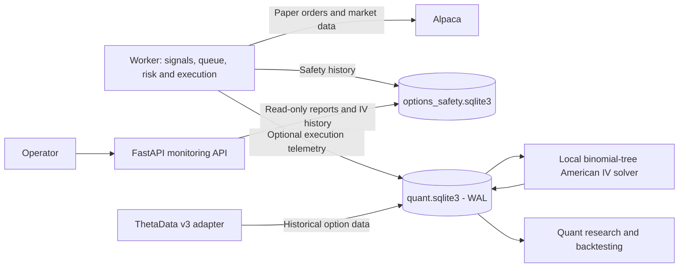

# Options Trading AI

**A paper-first options research and execution platform** combining market signals, risk-controlled order workflows, broker reconciliation, and quantitative telemetry.

## Problem and outcome

Options automation must make decisions with incomplete market data while controlling exposure and preserving an auditable execution trail. This project implements an automated research-to-execution workflow for directional options strategies, including **21–45 days to expiration (DTE) debit spreads**, with pre-trade guardrails and operator visibility.

- **Risk before routing:** quote freshness, spread width, intraday drift, catalyst blackout, IV rank, account and buying power, and exposure checks can hold or reject an order.
- **Paper-first execution:** multi-leg spread entry and paired-close workflows use the Alpaca paper endpoint; ambiguous submissions are reconciled by client order ID. Auto-submit defaults to off.
- **Isolated quantitative data:** `options_safety.sqlite3` stores safety history; a separate WAL-mode `quant.sqlite3` supports execution telemetry, historical market data, and backtesting data structures.
- **Local pricing:** a binomial-tree American option pricer with numerical root finding estimates implied volatility when suitable market data is available.
- **Operator visibility:** a FastAPI monitoring service exposes health, positions, guardrails, and IV history; a worker runs the research and execution cycle.

## Architecture

The worker and API share persisted output files; the API's outputs mount is read-only. ThetaData ingestion is a separate backfill workflow, not a prerequisite for the worker. The existing directional backtest also produces CSV reports; quant backtest tables are separate storage structures.

## Engineering tradeoffs

- **Fail closed vs. availability:** stale quotes, missing IV history, or catalyst uncertainty can block candidates. Strict IV rank needs at least 20 prior observations; the EOD recorder is not scheduled automatically.
- **Defined-risk spreads vs. simplicity:** paired legs reduce structural ambiguity but require quote validation, broker reconciliation, and manual review when legs or fills are degraded.
- **Separate databases vs. one source of truth:** WAL-mode quant storage isolates telemetry and historical research from the safety database, but the two IV histories are not automatically interchangeable.
- **Paper automation vs. production guarantees:** this is a research system, not a guarantee of returns or a complete account-wide risk platform. Deployment configuration and independent controls require operator review.

## Testing

The pytest suite exercises candidate selection, risk and catalyst holds, spread entry and exit paths, mocked broker responses, API behavior, quant ingestion, telemetry, and pricing. A local workspace run on November 17, 2026 reported **129 passed, 1 skipped**, including uncommitted local changes; results can differ by revision and environment.

## Local quickstart

Run these steps from the repository root. This is a local setup only; do not use live broker credentials.

1. **Configure paper mode.** Copy `.env.example` to `.env`, add Alpaca paper credentials and the API authentication settings, and retain `TRADING_MODE=paper`, `AUTO_SUBMIT=false`, and `CONFIRM_LIVE_TRADING=false`. Set `ALPACA_BASE_URL=https://paper-api.alpaca.markets`. Leave telemetry disabled unless explicitly needed.
2. **Start the API locally.** After reviewing the Compose configuration and ensuring Docker state is safe to use, run `docker compose up -d options-api`. The API listens on port 8080 inside its container; its Compose service does not publish a host port by default. See [README_DOCKER.md](README_DOCKER.md) for authentication and deployment details. Starting the worker is a separate operational decision.
3. **Run tests.** In a Python environment, run `python -m pip install -r requirements.txt pytest`, then `python -m pytest -q`.

No live-trading or financial-performance claims are implied. See [DISCLAIMER.md](DISCLAIMER.md).
